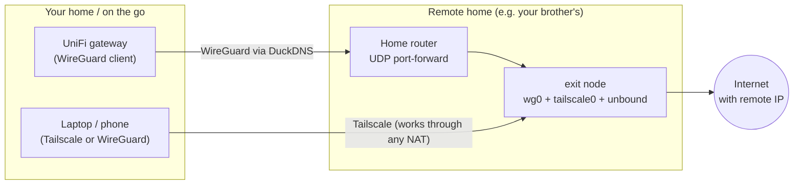

# remote-exit-node

Ansible project that turns a small Debian box (tested target: Dell Wyse 3040, Debian 13)
into an **unmanned residential exit node** in someone else's home — e.g. a family member
abroad — so you can browse from a clean, domestic IP of that country.



## Features

| Track | What | Notes |
|---|---|---|
| Tailscale | Exit node + Tailscale SSH | Primary management path; works even behind CGNAT |
| WireGuard | Native server for routers (UniFi) and devices | Port, subnet and peers are settings; client configs + QR codes generated locally |
| DuckDNS | Dynamic DNS for the WireGuard endpoint | systemd timer; token never in argv or world-readable files |
| DNS | `unbound` for WireGuard clients | Lookups exit from the remote IP: no DNS leak, correct geo-CDN |
| SSH | Key-only hardening; optional `sshguard` | For "SSH via DuckDNS", prefer SSH *through* WireGuard (see below) |
| Monitoring | Hardware watchdog, optional heartbeat (healthchecks.io) | Know when the box is down before you need it |
| Baseline | BBR, IPv4/IPv6 forwarding, journald cap, low swappiness, time sync, locales, security-only auto-updates with nightly reboot | eMMC friendly, no Docker |
| Manual | `artifacts/<node>/MANUAL.md` generated on every run | Everything needed to operate the node, incl. all WireGuard client configs |

Safety defaults: WireGuard clients cannot reach the remote LAN (`wireguard_block_lan`), IPv6 is
tunnelled (or black-holed) so it can't leak your real location, and every secret lives in
`ansible-vault`.

## Limitations

- **CGNAT**: the WireGuard and DuckDNS tracks need a public IPv4 on the remote router
  (inbound UDP port-forward). Many ISPs use CGNAT; check before relying on it:
  compare the router's WAN IP with `curl -4 ifconfig.me` from the remote network. If they
  differ, set `enable_wireguard: false` and `enable_duckdns: false` and use Tailscale only.
- Debian only (tested on 13 "trixie").
- Traffic leaves from the host's internet connection. Agree on that with them up front.

## Repository layout

```
ansible.cfg
site.yml
.env.example                   -> optional .env (gitignored) to pre-answer scripts/setup.sh
inventory.example.ini          reference; scripts/setup.sh writes inventory.ini (gitignored)
group_vars/all.yml             shared defaults + feature toggles (no secrets)
examples/host_vars/my-node/    reference; scripts/setup.sh writes host_vars/$NODE/ (gitignored)
roles/
  baseline/  ssh/  tailscale/  wireguard/  dns/  duckdns/  monitoring/  manual/
scripts/setup.sh               interactive setup: inventory, vars, encrypted vault, SSH key
scripts/wg-keys.sh             generate extra WireGuard keys as vault YAML (stdout only)
artifacts/                     generated client configs + MANUAL.md (gitignored, contain private keys)
```

## Secrets and this public repo

- `.env`, `inventory.ini`, `host_vars/`, `artifacts/` and any `vault*.yml` under `group_vars/` are gitignored.
- `.env` holds your answers including tokens (Tailscale key, DuckDNS token, heartbeat URL),
  but never the sudo password. Back it up privately (e.g. 1Password) together with the vault
  password and `artifacts/<node>/MANUAL.md`.
- Enable the pre-commit hooks (gitleaks + "vault must be encrypted"):
  `pipx install pre-commit && pre-commit install`.
- CI runs ansible-lint, a syntax check and gitleaks on every push.

## 0. What you need

| Item | Notes |
|---|---|
| Node name | e.g. `hk-node`; used for the inventory, `host_vars/`, and Tailscale hostname |
| Node host | LAN IP or hostname reachable from your Mac during setup (check: `ping -c1 <host>`). A LAN IP is the most reliable; hostnames depend on your router's DNS (UniFi registers DHCP names) or mDNS (`<name>.local`, needs `avahi-daemon` on the node) |
| Node user + sudo password | The Debian user you created at install |
| Tailscale auth key | See step 2 |
| DuckDNS subdomain + token | Free: sign in at https://www.duckdns.org (GitHub/Google/…), add a subdomain (the IP shown doesn't matter, the node updates it), copy the **token** at the top. Skip if you don't use WireGuard |
| WireGuard client names | One per device that connects without Tailscale, e.g. `unifi phone`. Each gets its own config + keys |

## 1. Prerequisites (control node)

```bash
pipx install --include-deps ansible       # or: brew install ansible
brew install wireguard-tools qrencode     # wg for key generation, qrencode for phone QR codes
```

On the node: Debian installed, SSH enabled, a sudo user. The setup script (step 3) creates
and copies the SSH key. The playbook then disables SSH password login (keep it with
`ssh_password_auth: true`), and refuses to if the login user has no `authorized_keys`.

## 2. Tailscale preparation

You need a Tailscale account (free plan is enough). No policy changes are required; the
node joins as one of your own devices.

### 2.1 Create the auth key

https://login.tailscale.com/admin/settings/keys → **Generate auth key…**

| Option | Value | Why |
|---|---|---|
| Reusable | **Off** | A one-off key is consumed on join, so a leaked vault can't add devices |
| Expiration | e.g. 7 days | Only needs to live until the first playbook run; it does **not** affect the node afterwards |
| Ephemeral | **Off** | Ephemeral nodes are deleted when offline, e.g. after a power cut |
| Pre-approved | **On** (only shown if device approval is enabled) | Nobody has to approve it remotely |

Copy the `tskey-auth-…` value right away; it is shown only once. The setup script asks for
it in step 3. Prefer a browser login? Leave it empty; the first playbook run stops at the
Tailscale step. Then run `sudo tailscale up` on the node, open the printed URL, and re-run.

### 2.2 After the first playbook run (required)

In **Machines** → the node → `…` menu:

1. **Disable key expiry.** Otherwise the node logs out after ~180 days, and on an unmanned
   box that means someone has to fix it on site.
2. **Edit route settings** → tick **Use as exit node**.

### 2.3 Use it from your devices

- Desktop / mobile app: **Exit node** → pick the node. Optionally enable
  **Allow local network access** so your own LAN (printer, NAS) keeps working.
- CLI: `tailscale set --exit-node="$NODE" --exit-node-allow-lan-access`; turn off with
  `tailscale set --exit-node=`.
- SSH: `tailscale ssh "$NODE_USER@$NODE"`.

Shared tailnet? With the default allow-all policy, anyone using the exit node can also reach
the remote home's LAN. Restrict that with Tailscale grants (`autogroup:internet`) if needed.

## 3. Configure

```bash
cp .env.example .env && code .env      # optional: pre-fill answers
scripts/setup.sh
```

The script asks for anything not set in `.env`, then:

- creates the SSH key if missing and copies it to the node if key login doesn't work yet,
- writes/updates this node's line in `inventory.ini`,
- writes `host_vars/$NODE/vars.yml` (WireGuard clients get `10.88.0.2`, `.3`, …),
- generates WireGuard keys for the server and every client,
- writes `host_vars/$NODE/vault.yml` **encrypted**. You choose the vault password here; every
  later `ansible-vault edit` / `--ask-vault-pass` asks for it, so keep it in your password manager,
- saves the answers to `.env` (including tokens, never the sudo password) and installs the
  Ansible collections.

Re-running is safe: it asks before overwriting `vars.yml` or the vault. Overwriting the vault
regenerates WireGuard keys, so existing client configs stop working.

The remaining commands in this README use the `.env` values; load them into your shell with:

```bash
set -a; . ./.env; set +a
```

To change secrets later:

```bash
EDITOR="code --wait" ansible-vault edit "host_vars/$NODE/vault.yml"   # decrypts into the editor, re-encrypts on close
```

Fine-tuning: add any setting to `host_vars/$NODE/vars.yml` (see `group_vars/all.yml` and
`roles/*/defaults/main.yml` for all):

| Variable | Default | Purpose |
|---|---|---|
| `enable_*` | see file | Turn tracks on/off |
| `wireguard_port` | `51822` | Must differ from any WireGuard port already used on the client gateway (UniFi's own server/clients often use 51820) |
| `wireguard_ipv4_network` / `_ipv6_network` | `10.88.0.0/24` / `fd88:88::/64` | Must not overlap your LAN, the remote LAN, or `100.64.0.0/10` |
| `wireguard_peers` | `[]` | One entry per client: `name`, `ipv4`, `ipv6`, keys, optional `allowed_ips`, `mtu`, `keepalive` |
| `wireguard_block_lan` | `true` | Stop tunnel clients from reaching the host's LAN |
| `duckdns_domain` | `""` | Subdomain only |
| `node_timezone` | `UTC` | |
| `ssh_password_auth` | `false` | SSH password login (sudo and console always accept the password) |
| `baseline_unattended_reboot` / `_time` | `true` / `04:30` | Automatic reboot after kernel updates, local time |

Adding a client later without touching existing ones: `scripts/wg-keys.sh --no-server laptop`,
paste the output under `vault_wireguard_peers` (`ansible-vault edit`), add a matching entry to
`wireguard_peers` in `vars.yml`, re-run the playbook.

## 4. Run

```bash
ansible-playbook site.yml --limit "$NODE" --ask-vault-pass
ansible-playbook site.yml --limit "$NODE" --ask-vault-pass      # second run must report changed=0
```

Client configs land in `artifacts/$NODE/<peer>.conf` (+ `.png` QR codes), mode 0600.

The last step writes `artifacts/$NODE/MANUAL.md`: login paths, router port-forward details
(with the box's MAC), instructions for the person on site, every WireGuard client config,
health checks and troubleshooting. It contains private keys; store it in your password manager.
Refresh it alone with `--tags manual`.

After the box moves to the remote home, point `ansible_host` at its Tailscale name to keep
managing it:

```bash
sed -i '' "/^$NODE /s/ansible_host=[^ ]*/ansible_host=$NODE/" inventory.ini   # macOS sed
```

## 5. Manual steps

**Before it leaves your hands**

- BIOS (Wyse 3040: F2 at boot) → Power Management → **AC Recovery = Power On**.
  Without this the box stays off after a power cut.
- Power test: unplug, wait 10 s, plug in → it rejoins the tailnet and `wg0` comes up.

**At the remote router**

- DHCP reservation for the node's MAC.
- Port-forward **UDP `wireguard_port` → node**.
- Optional, only if you need direct SSH from the internet: forward a high TCP port
  (e.g. 22022) → node:22 and set `enable_ssh_public: true` (installs sshguard).
  Usually unnecessary: connect WireGuard, then `ssh "$NODE_USER@10.88.0.1"`. That exposes
  nothing but one UDP port, which doesn't answer unauthenticated packets.
- Reaching the router's admin page later needs no subnet route: tunnel through the node with
  `ssh -L 8080:<router-ip>:80 "$NODE_USER@$NODE"` and open http://localhost:8080.

**UniFi gateway (your home)**

- Settings → VPN → VPN Client → Create New → WireGuard → upload one client config, e.g.
  `artifacts/$NODE/unifi.conf` (also included in `MANUAL.md`).
- The config has no `ListenPort` on purpose; it would collide with other WireGuard
  tunnels on the gateway (`EADDRINUSE`, stuck on "Connecting").
- Settings → Routing → Traffic Routes → send chosen devices/domains through the new client.
- If the import rejects IPv6, remove `ipv6` from the `unifi` peer and set
  `allowed_ips: 0.0.0.0/0`. Then disable IPv6 for the routed devices, or their IPv6
  traffic will bypass the tunnel.

## 6. Verify

```bash
ssh "$NODE_USER@$NODE" 'tailscale status'                         # node online, exit node offered
ssh -t "$NODE_USER@$NODE" 'sudo wg show'                          # listening on wireguard_port, handshakes
ssh "$NODE_USER@$NODE" 'systemctl list-timers duckdns-update.timer'
dig +short "$DUCKDNS_DOMAIN.duckdns.org"                          # equals the remote WAN IP
```

From a device routed through the node (WireGuard or Tailscale exit node):

- `curl -4 ifconfig.me` → remote country IP.
- `curl -6 ifconfig.me` → remote IPv6, or a failure. **Never your own IPv6.**
- https://dnsleaktest.com → only resolvers in the remote country.
- `tailscale ssh "$NODE_USER@$NODE"` works.

## Troubleshooting

- **UniFi stuck on "Connecting"**: port forward missing, wrong `wireguard_port`, or DuckDNS
  not updated (`journalctl -u duckdns-update`).
- **Slow / stalled pages over WireGuard**: MTU. Set `wireguard_mtu: 1380` (or per peer `mtu`).
- **Tailscale re-join**: auth keys expire (90 days max). Once joined the node stays joined;
  only a fresh install needs a new key in the vault.
